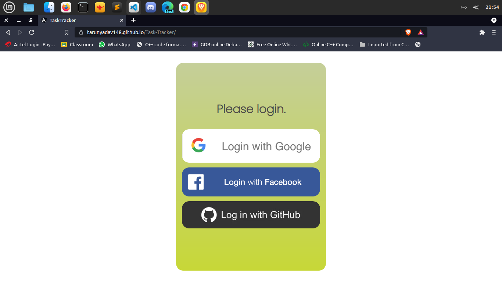
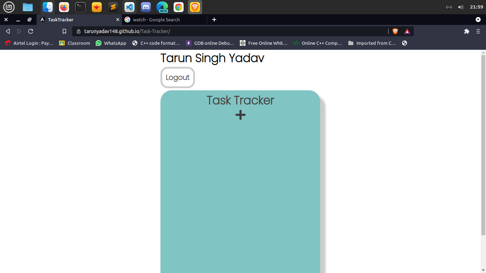
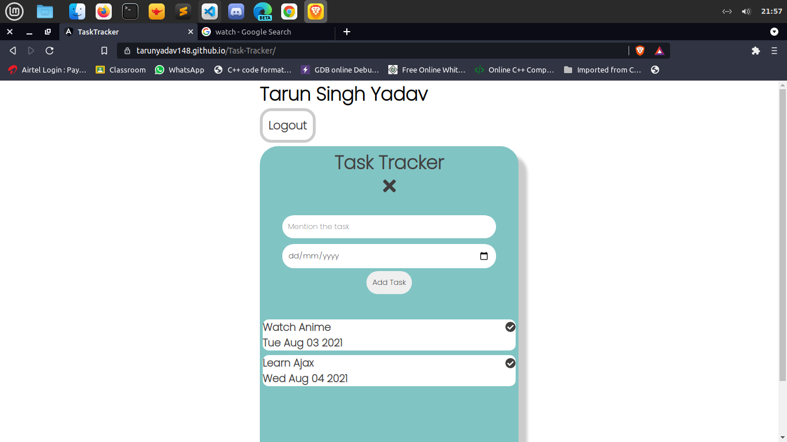
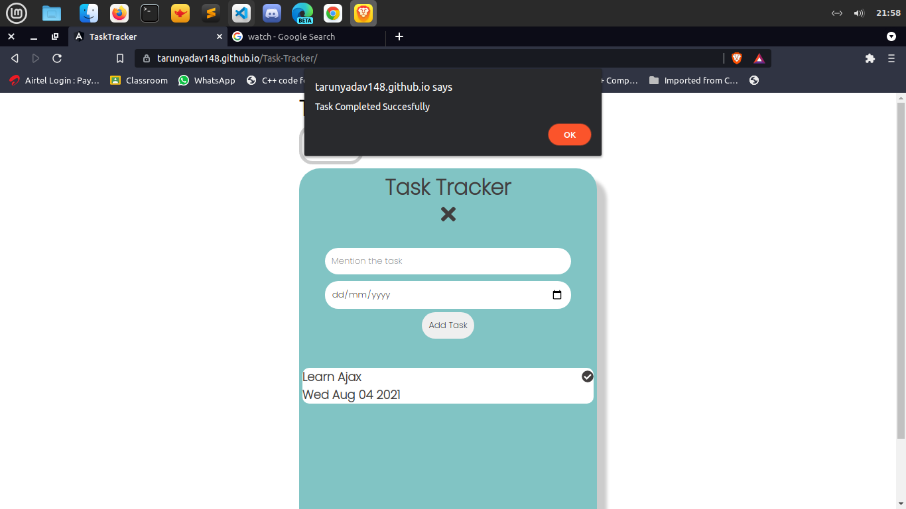

# ✅ Task Tracker

A full-stack task management web app built with **Angular** and **Firebase** — with real-time sync, social login, and live deployment.

   

🔗 **[Live Demo](https://tarunyadav148.github.io/Task-Tracker/)**

---

## ✨ Features

- 🔐 Social login — Google, Facebook, GitHub (via Firebase Auth)
- ➕ Add tasks with a name and due date
- ✅ Mark tasks as complete (one click → done, second click → delete)
- 🔔 Toggle reminder on any task
- 🗑️ Delete tasks instantly
- ☁️ Real-time sync with Firebase Realtime Database — data persists per user
- 📱 Responsive layout

---

## 📸 Screenshots

| Login | Dashboard |
|---|---|
|  |  |

| Add Task | Completed Task |
|---|---|
|  |  |

---

## 🏗️ Architecture

```
┌─────────────────────────────────────────────────────────┐
│                    Angular SPA                           │
│                                                         │
│  ┌──────────┐    ┌─────────────────────────────────┐   │
│  │  Login   │    │          Dashboard               │   │
│  │Component │    │  ┌──────────┐  ┌─────────────┐  │   │
│  │          │    │  │ AddTask  │  │  TaskList   │  │   │
│  │ Google   │    │  │Component │  │  Component  │  │   │
│  │ Facebook │    │  └────┬─────┘  └──────┬──────┘  │   │
│  │ GitHub   │    │       │               │          │   │
│  └────┬─────┘    │       └───────┬───────┘          │   │
│       │          │               │                  │   │
│       └──────────┴───────────────┘                  │   │
│                          │                          │   │
│                 DatabaseService                     │   │
│                 (AngularFire)                       │   │
└──────────────────────────┼──────────────────────────┘
                           │
              ┌────────────┴────────────┐
              │      Firebase           │
              │  ┌──────────────────┐   │
              │  │  Authentication  │   │
              │  │  Google/FB/GH    │   │
              │  └──────────────────┘   │
              │  ┌──────────────────┐   │
              │  │  Realtime DB     │   │
              │  │  /users/{uid}/   │   │
              │  └──────────────────┘   │
              └─────────────────────────┘
```

---

## 🔄 Data Flow

### Login Flow
```
User clicks "Login with Google"
        │
        ▼
Firebase Auth → signInWithPopup(GoogleAuthProvider)
        │
        ▼
DatabaseService.setUserUid(user.uid)
        │
        ▼
All DB operations scoped to /users/{uid}/
```

### Task CRUD Flow
```
Add Task                     Complete Task
    │                              │
    ▼                              ▼
AddTaskComponent           TaskItemComponent
  validate form               setStatus(id)
  check date ≥ today              │
    │                         status=false → set true → updateTaskInDB
    ▼                         status=true  → removeFromDB
DatabaseService
  .addTaskToDB(task)
  push to /users/{uid}/
  update with generated key
```

---

## 📁 Project Structure

```
Task-Tracker/
├── src/app/
│   ├── components/
│   │   ├── login/          # Social auth login screen
│   │   ├── dashboard/      # Main layout, toggle add-task panel
│   │   ├── add-task/       # Task form with date validation
│   │   ├── task-list/      # Renders list of task-item components
│   │   ├── task-item/      # Single task — complete, remind, delete
│   │   └── header/         # App header
│   ├── services/
│   │   └── database-service.service.ts  # All Firebase CRUD operations
│   └── app.module.ts       # AngularFire, FontAwesome, FormsModule
├── firebase.json           # Firebase Hosting config
├── screenshot/             # App screenshots
└── angular.json            # Angular CLI config
```

---

## 🗄️ Firebase Data Structure

```json
{
  "users": {
    "{uid}": {
      "{taskId}": {
        "id": "taskId",
        "task": "Buy groceries",
        "date": "Wed May 10 2026",
        "reminder": false,
        "status": false
      }
    }
  }
}
```

---

## 🛠️ Tech Stack

| Technology | Purpose |
|---|---|
| Angular 12 | SPA framework |
| TypeScript | Language |
| Firebase Auth | Google / Facebook / GitHub login |
| Firebase Realtime DB | Real-time task storage per user |
| AngularFire | Angular Firebase SDK |
| FontAwesome | Icons (plus, times, check-circle) |
| GitHub Pages | Frontend hosting |

---

## 🚀 Getting Started

### Prerequisites
- Node.js 14+
- Angular CLI: `npm install -g @angular/cli`
- A Firebase project with Auth and Realtime Database enabled

### Setup

```bash
# 1. Clone the repo
git clone https://github.com/tarunyadav148/Task-Tracker.git
cd Task-Tracker

# 2. Install dependencies
npm install

# 3. Add Firebase config
# Create src/environments/environment.ts with your Firebase project config:
```

```ts
export const environment = {
  production: false,
  firebase: {
    apiKey: "YOUR_API_KEY",
    authDomain: "YOUR_PROJECT.firebaseapp.com",
    databaseURL: "https://YOUR_PROJECT-default-rtdb.firebaseio.com",
    projectId: "YOUR_PROJECT_ID",
    storageBucket: "YOUR_PROJECT.appspot.com",
    messagingSenderId: "YOUR_SENDER_ID",
    appId: "YOUR_APP_ID"
  }
};
```

```bash
# 4. Run locally
ng serve
# Open http://localhost:4200
```

### Build & Deploy

```bash
# Build
ng build --prod

# Deploy to Firebase Hosting
firebase deploy
```

---

## 📄 License

MIT
